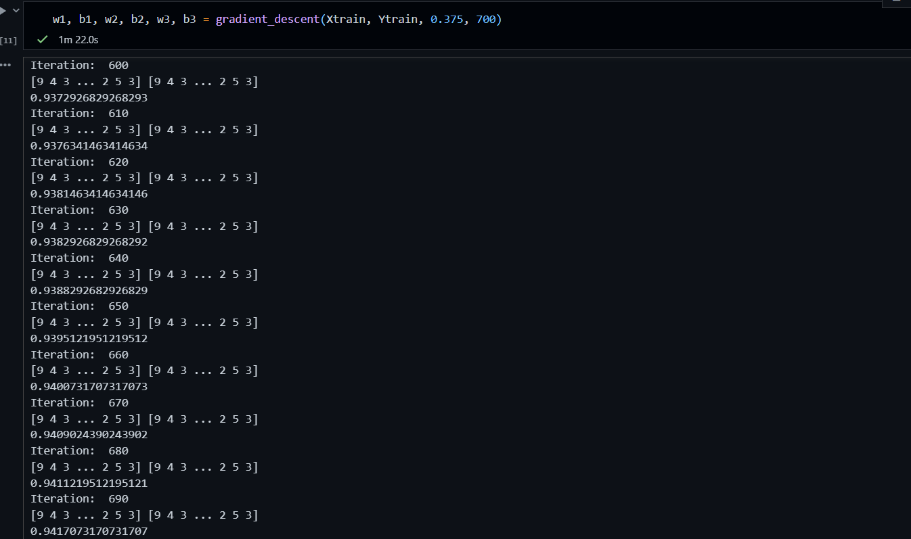
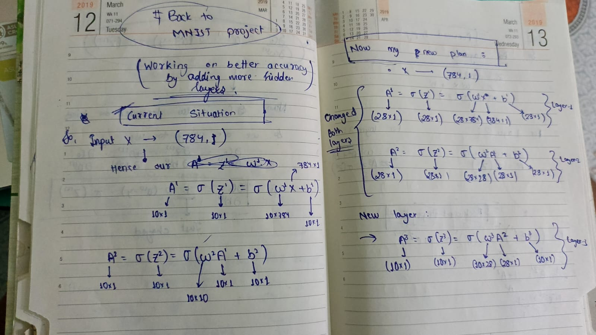
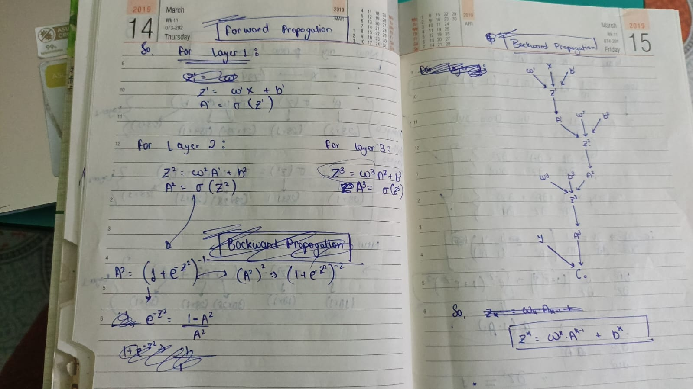
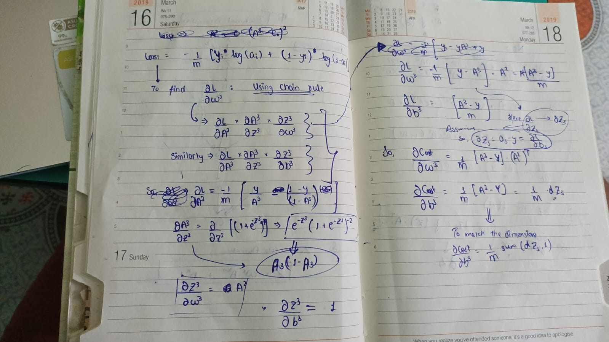
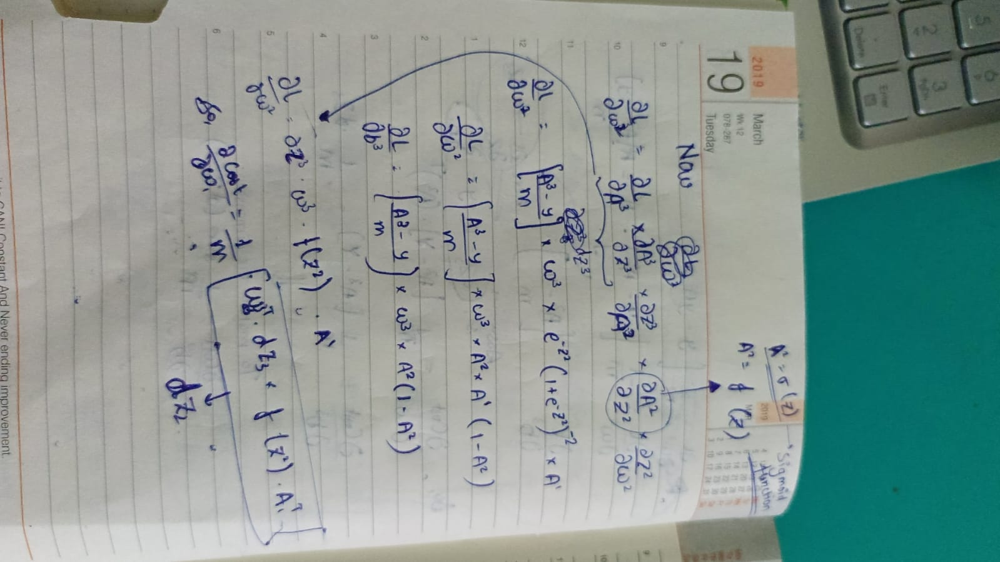
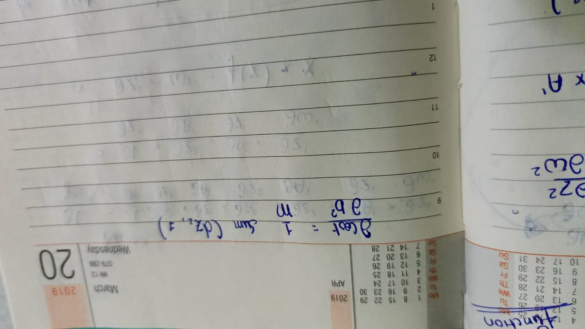
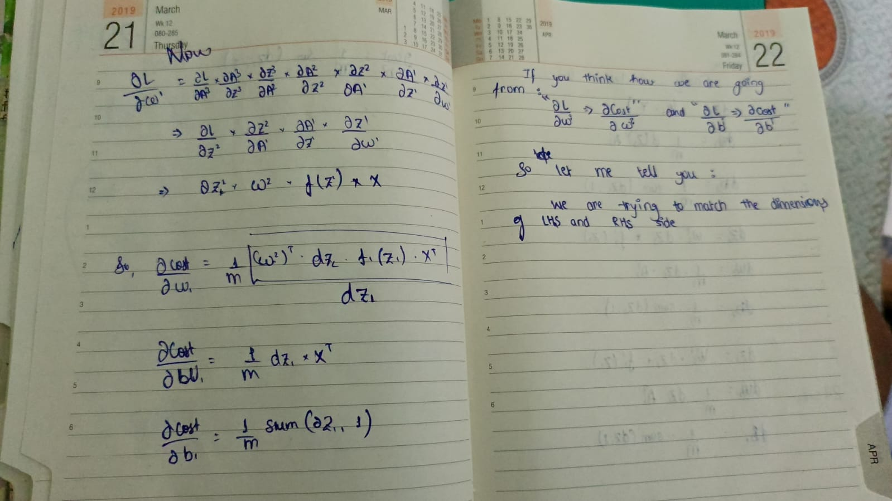
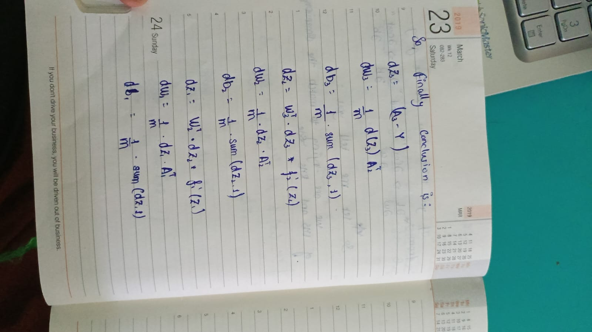

# MNIST Digit Prediction - Neural Network from Scratch with NumPy

> Implemented a neural network from scratch using NumPy, translating forward propagation, backpropagation, activation functions, and gradient descent into mathematical operations.

An interactive handwritten-digit classifier powered by a neural network built entirely from scratch with NumPy. No TensorFlow, no PyTorch, no high-level frameworks - just matrix math, calculus, and Python.

This README documents the complete derivation, including original handwritten notes used while developing the model.

**Dataset:** MNIST - 70,000 images of handwritten digits (60,000 train + 10,000 test), each 28x28 grayscale, 10 classes (0-9).

**Repo:** https://github.com/HelloSamved/learning-neural-network/tree/master/mnist_prediction

---

## Table of Contents

- [Overview](#overview)
- [Results](#results)
- [Features](#features)
- [Network Architecture](#network-architecture)
- [How It Works](#how-it-works)
- [Math Behind the Code](#math-behind-the-code)
- [Handwritten Derivation Notes](#handwritten-derivation-notes)
- [Project Structure](#project-structure)
- [Getting Started](#getting-started)
- [Usage](#usage)
- [Training Details](#training-details)
- [Future Improvements](#future-improvements)
- [Acknowledgements](#acknowledgements)
- [License](#license)

---

## Overview

This project builds a 3-layer fully-connected neural network (Multilayer Perceptron) to classify MNIST digits:

- Input: flattened 28x28 image = 784 values, normalized from [0,255] to [0,1]
- Hidden layers: 2 layers with 28 neurons each, sigmoid activation
- Output layer: 10 neurons (one per digit), sigmoid / softmax activation
- Training: full-batch gradient descent with backpropagation derived by hand

Everything - forward pass, loss, gradients, weight updates - is written explicitly with NumPy.

---

## Results

Final training run:

```
w1, b1, w2, b2, w3, b3 = gradient_descent(Xtrain, Ytrain, 0.375, 700)
Iteration 690: accuracy = 0.9417
```

- Training accuracy: ~94.1 percent after 700 iterations, learning rate 0.375
- Validation accuracy: ~94.7 percent (see web_interface.py / mnist_weights.npz)
- Inference: pretrained weights included, no retraining needed for demo

Training log screenshot:



---

## Features

- Neural network from scratch using only NumPy, Pandas, Matplotlib
- Forward propagation, backpropagation, and gradient descent implemented manually
- 784 -> 28 -> 28 -> 10 dense architecture
- Binary cross-entropy / categorical loss with chain-rule gradients
- Pretrained weights (mnist_weights.npz) for fast inference
- Streamlit web interface: upload images, confidence visualization, MNIST sample explorer
- Preprocessing: centering, normalization to 28x28 inputs
- Fully documented math + original handwritten derivations (see below)

---

## Network Architecture

```
Input (784) -> Hidden Layer 1 (28, sigmoid) -> Hidden Layer 2 (28, sigmoid) -> Output (10, sigmoid)
```

Shapes (m = number of examples):

| Variable | Shape | Description |
|----------|-------|-------------|
| X | (784, m) | Input images, flattened and normalized |
| W1 | (28, 784) | Weights layer 1 |
| b1 | (28, 1) | Bias layer 1 |
| A1 | (28, m) | Activation layer 1 |
| W2 | (28, 28) | Weights layer 2 |
| b2 | (28, 1) | Bias layer 2 |
| A2 | (28, m) | Activation layer 2 |
| W3 | (10, 28) | Weights layer 3 |
| b3 | (10, 1) | Bias layer 3 |
| A3 | (10, m) | Output probabilities |

Total trainable parameters: (28*784 + 28) + (28*28 + 28) + (10*28 + 10) = 23,082

---

## How It Works

1. Preprocessing:
   - Load train.csv / test.csv
   - Divide pixels by 255.0 to get range [0,1]
   - Flatten each 28x28 image to vector of length 784
   - One-hot encode labels for training, keep integer labels for evaluation

2. Forward propagation: compute Z = W dot A_prev + b, then A = sigmoid(Z) layer by layer.

3. Compute loss (binary cross-entropy averaged over m examples).

4. Backpropagation: apply chain rule from output backwards to compute dW1, db1, dW2, db2, dW3, db3.

5. Gradient descent: W = W - alpha * dW, b = b - alpha * db, repeat for N iterations.

6. Prediction: predicted class = argmax(A3, axis=0).

---

## Math Behind the Code

All equations use plain notation so they render correctly everywhere. Here:
- Wk = weights of layer k, bk = bias of layer k
- Zk = linear output of layer k, Ak = activation of layer k
- Y = true labels (one-hot), m = number of examples
- sigmoid(z) = 1 / (1 + exp(-z))
- f'(z) = derivative of activation

### 1. Forward Propagation

General rule for layer k:

```
Zk = Wk dot A(k-1) + bk
Ak = sigmoid(Zk)
```

Expanded for this network (A0 = X):

```
Z1 = W1 dot X + b1
A1 = sigmoid(Z1)

Z2 = W2 dot A1 + b2
A2 = sigmoid(Z2)

Z3 = W3 dot A2 + b3
A3 = sigmoid(Z3)
```

Python (NumPy):

```python
def sigmoid(z):
    return 1 / (1 + np.exp(-z))

Z1 = np.dot(W1, X) + b1
A1 = sigmoid(Z1)

Z2 = np.dot(W2, A1) + b2
A2 = sigmoid(Z2)

Z3 = np.dot(W3, A2) + b3
A3 = sigmoid(Z3)
```

### 2. Loss Function

Binary cross-entropy (averaged over m examples):

```
Loss = -(1/m) * sum( Y * log(A3) + (1 - Y) * log(1 - A3) )
```

```python
m = X.shape[1]
loss = -(1/m) * np.sum(Y * np.log(A3 + 1e-8) + (1 - Y) * np.log(1 - A3 + 1e-8))
```

### 3. Activation Derivative

```
sigmoid(z) = 1 / (1 + exp(-z))
dA/dZ = A * (1 - A)
```

```python
def sigmoid_derivative(A):
    return A * (1 - A)
```

### 4. Backpropagation (Chain Rule)

Output layer error term:

```
dZ3 = A3 - Y
dW3 = (1/m) * dot(dZ3, A2.T)
db3 = (1/m) * sum(dZ3, axis=1, keepdims=True)
```

Hidden layer 2:

```
dZ2 = dot(W3.T, dZ3) * A2 * (1 - A2)
dW2 = (1/m) * dot(dZ2, A1.T)
db2 = (1/m) * sum(dZ2, axis=1, keepdims=True)
```

Hidden layer 1:

```
dZ1 = dot(W2.T, dZ2) * A1 * (1 - A1)
dW1 = (1/m) * dot(dZ1, X.T)
db1 = (1/m) * sum(dZ1, axis=1, keepdims=True)
```

That is the full chain:

```
dL/dW1 = (dL/dA3) * (dA3/dZ3) * (dZ3/dA2) * (dA2/dZ2) * (dZ2/dA1) * (dA1/dZ1) * (dZ1/dW1)
```

Final compact summary (as derived in notes):

```
dZ3 = (A3 - Y)
dW3 = (1/m) * dZ3 dot A2.T
db3 = (1/m) * sum(dZ3)

dZ2 = W3.T dot dZ3 * f2'(Z2)
dW2 = (1/m) * dZ2 dot A1.T
db2 = (1/m) * sum(dZ2)

dZ1 = W2.T dot dZ2 * f1'(Z1)
dW1 = (1/m) * dZ1 dot X.T
db1 = (1/m) * sum(dZ1)
```

### 5. Gradient Descent Update

```
Wk = Wk - alpha * dWk
bk = bk - alpha * dbk
```

```python
W1 -= learning_rate * dW1
b1 -= learning_rate * db1
W2 -= learning_rate * dW2
b2 -= learning_rate * db2
W3 -= learning_rate * dW3
b3 -= learning_rate * db3
```

Used in this project: alpha = 0.375, iterations = 700.

Weight initialization (small random values):

```python
np.random.seed(42)
W1 = np.random.randn(28, 784) * 0.01
b1 = np.zeros((28, 1))
W2 = np.random.randn(28, 28) * 0.01
b2 = np.zeros((28, 1))
W3 = np.random.randn(10, 28) * 0.01
b3 = np.zeros((10, 1))
```

---

## Handwritten Derivation Notes

These are the original diary notes used to derive the network. They are kept in `mnist_prediction/assets/` and linked below.

### Note 1 - Architecture plan: from 2 layers to 3 layers

Working on better accuracy by adding more hidden layers. Current: Input X (784,1). New plan: X (784,1) -> A1 (28,1) -> A2 (28,1) -> A3 (10,1).



What it shows:

```
A1 = sigmoid(Z1) = sigmoid(W1 dot X + b1)
A2 = sigmoid(Z2) = sigmoid(W2 dot A1 + b2)
A3 = sigmoid(Z3) = sigmoid(W3 dot A2 + b3)
```

with shapes W1:(28,784), W2:(28,28), W3:(10,28).

### Note 2 - Forward and backward propagation setup

Defines forward equations per layer and sets up the computation graph for backprop: X,b1 -> Z1 -> A1, with W2,b2 -> Z2 -> A2, with W3,b3 -> Z3 -> A3, with Y -> Cost C. General rule: Zk = Wk dot A(k-1) + bk.



### Note 3 and 4 - Chain rule for output layer (W3, b3)

Loss:

```
Loss = -(1/m) * [ Y * log(A3) + (1-Y) * log(1-A3) ]
```

Derivation:

```
dL/dW3 = (dL/dA3) * (dA3/dZ3) * (dZ3/dW3)
dL/db3 = (dL/dA3) * (dA3/dZ3) * (dZ3/db3)
```

where:

```
dL/dA3 = -(1/m) * [ Y/A3 - (1-Y)/(1-A3) ]
dA3/dZ3 = A3 * (1-A3)
dZ3/dW3 = A2,  dZ3/db3 = 1
```

Simplified result:

```
dZ3 = A3 - Y
dW3 = (1/m) * dZ3 dot A2.T
db3 = (1/m) * sum(dZ3)
```





### Note 5 - Hidden layer 2 gradients (W2, b2)

```
dL/dW2 = (dL/dA3)*(dA3/dZ3)*(dZ3/dA2)*(dA2/dZ2)*(dZ2/dW2)
dZ2 = W3.T dot dZ3 * f'(Z2)
dW2 = (1/m) * dZ2 dot A1.T
db2 = (1/m) * sum(dZ2)
```

Explains dimension matching of LHS and RHS by summing over axis=1.



### Note 6 - Hidden layer 1 gradients (W1, b1)

```
dL/dW1 = (dL/dZ2)*(dZ2/dA1)*(dA1/dZ1)*(dZ1/dW1)
dZ1 = W2.T dot dZ2 * f'(Z1)
dW1 = (1/m) * dZ1 dot X.T
db1 = (1/m) * sum(dZ1)
```



### Note 7 - Final conclusion (all update equations)

Complete set used in code:

```
dZ3 = (A3 - Y)
dW3 = (1/m) * dZ3 dot A2.T
db3 = (1/m) * sum(dZ3, axis=1)

dZ2 = W3.T dot dZ3 * f2'(Z2)
dW2 = (1/m) * dZ2 dot A1.T
db2 = (1/m) * sum(dZ2, axis=1)

dZ1 = W2.T dot dZ2 * f1'(Z1)
dW1 = (1/m) * dZ1 dot X.T
db1 = (1/m) * sum(dZ1, axis=1)
```



Source folder: https://github.com/HelloSamved/learning-neural-network/tree/master/mnist_prediction/assets

---

## Project Structure

```
mnist_prediction/
  mnist_prediction.ipynb        # original model exploration and learning notebook
  mnist-prediction.ipynb        # alternate / full training notebook
  mnist_prediction.py           # corrected reusable neural-network + preprocessing code
  mnist_prediction_pytorch.ipynb# PyTorch comparison version
  web_interface.py              # Streamlit app: upload, confidence chart, sample explorer
  mnist_weights.npz             # pretrained W1,b1,W2,b2,W3,b3 + accuracy metadata
  mnist_samples.npz             # lightweight sample set for live explorer
  train.csv                     # MNIST training data (if present locally, not committed)
  assets/
    1.jpeg                      # handwritten note: architecture
    2.jpeg                      # handwritten note: forward/backward setup
    3.jpeg                      # handwritten note: loss + chain rule
    4.jpeg                      # handwritten note: dW3, db3 derivation
    5.jpeg                      # handwritten note: dW2, db2 derivation
    6.jpeg                      # handwritten note: dW1, db1 derivation
    7.jpeg                      # handwritten note: final equations
    accuracy_image.png          # training log screenshot
```

---

## Getting Started

### Prerequisites

- Python 3.8+
- pip

### 1. Clone the repository

```bash
git clone https://github.com/HelloSamved/learning-neural-network.git
cd learning-neural-network/mnist_prediction
```

### 2. Install dependencies

```bash
pip install -r requirements.txt
```

Minimum requirements:

```
numpy>=1.21.0
pandas>=1.3.0
matplotlib>=3.4.0
streamlit>=1.20.0
scikit-learn>=1.0.0
```

### 3. Get MNIST data

Option A - Kaggle CSV (used in notebooks):
1. Download from https://www.kaggle.com/datasets/oddrationale/mnist-in-csv
2. Place train.csv and test.csv next to mnist_prediction.py

Option B - Auto-download with sklearn (no CSV needed):

```python
from sklearn.datasets import fetch_openml
X, y = fetch_openml('mnist_784', version=1, return_X_y=True, as_frame=False)
```

---

## Usage

### Run the web app (recommended)

```bash
streamlit run web_interface.py
```

Features: upload your own digit image, see predicted digit + confidence bar chart, browse real MNIST samples.

### Retrain from scratch

```bash
python mnist_prediction.py
```

Or in Python:

```python
from mnist_prediction import gradient_descent, predict
import numpy as np

# Xtrain shape (784, m), Ytrain one-hot shape (10, m)
w1, b1, w2, b2, w3, b3 = gradient_descent(Xtrain, Ytrain, learning_rate=0.375, iterations=700)

pred = predict(Xtest, w1, b1, w2, b2, w3, b3)
acc = np.mean(pred == Ytest_labels)
print(f"Test accuracy: {acc * 100:.2f}%")
```

### Predict a single image

```python
import numpy as np
from PIL import Image
from mnist_prediction import predict_single

img = Image.open("my_digit.png").convert("L").resize((28, 28))
x = (255 - np.array(img)).reshape(784, 1) / 255.0  # invert if white background
label, probs = predict_single(x, w1, b1, w2, b2, w3, b3)
print(f"Predicted: {label}, confidence: {np.max(probs)*100:.1f}%")
```

Note: MNIST digits are white on black. If you draw black on white, invert the image as above.

---

## Training Details

- Architecture: 784 -> 28 -> 28 -> 10
- Activation: sigmoid for all layers
- Loss: cross-entropy
- Optimizer: batch gradient descent
- Learning rate: 0.375
- Iterations: 700
- Initialization: random * 0.01, biases zero, seed 42 for reproducibility
- Preprocessing: pixels / 255.0, flatten to (784, m)

Observed progression (see accuracy_image.png):

```
Iteration 600: ~0.9372
Iteration 650: ~0.9395
Iteration 690: ~0.9417
```

Tips:
- Increase hidden units to 64 or 128 for higher accuracy, slower training
- Lower learning rate to 0.1-0.2 if loss oscillates
- Switch hidden activation to ReLU + He init + softmax output for faster convergence

---

## Future Improvements

- [ ] Add ReLU + Softmax + Adam variant for comparison
- [ ] Add CNN with NumPy for 99 percent+ accuracy
- [ ] Add confusion matrix and per-digit precision/recall
- [ ] Add live drawing canvas in Streamlit app
- [ ] Export model to ONNX

---

## Acknowledgements

- MNIST Database - Yann LeCun, Corinna Cortes, Christopher Burges: http://yann.lecun.com/exdb/mnist/
- Michael Nielsen - Neural Networks and Deep Learning: http://neuralnetworksanddeeplearning.com/
- 3Blue1Brown - Neural Networks series for visual intuition
- Handwritten notes in assets/ by the project author, derived March 2019

---

## License

MIT License. See LICENSE file for details. If no LICENSE file exists, all code and notes in this repository are shared for learning purposes - please credit the author when reusing.

---

If you found this helpful, please star the repo: https://github.com/HelloSamved/learning-neural-network

Built with NumPy and pure mathematics - no deep learning frameworks.
